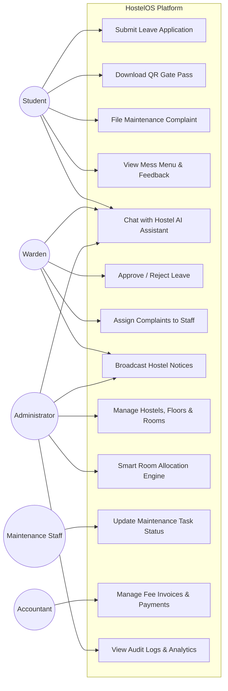
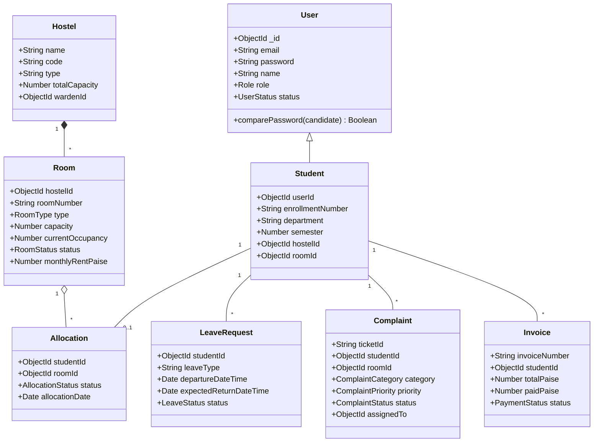
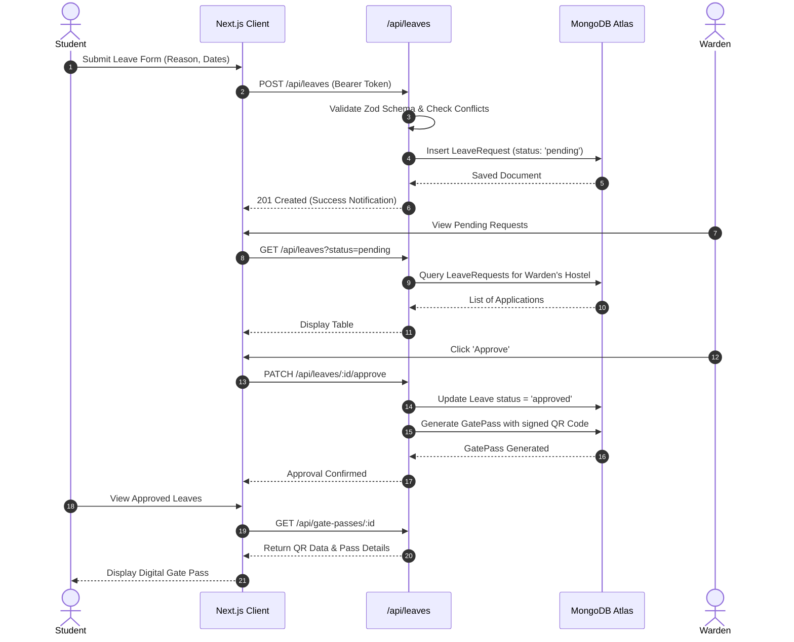
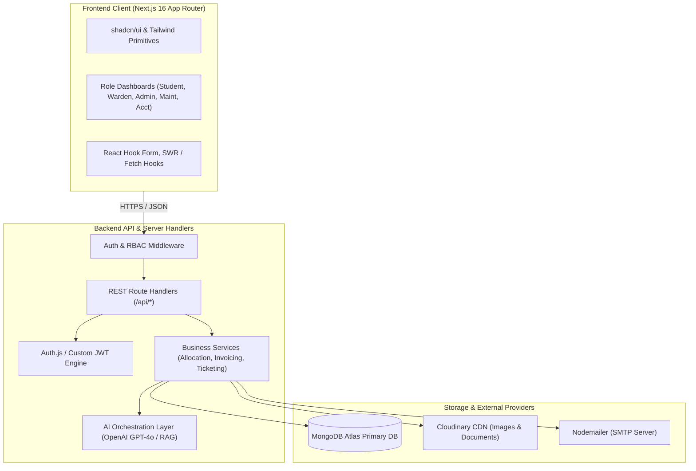
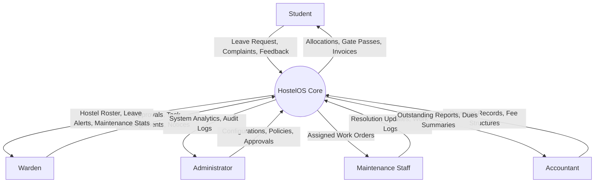
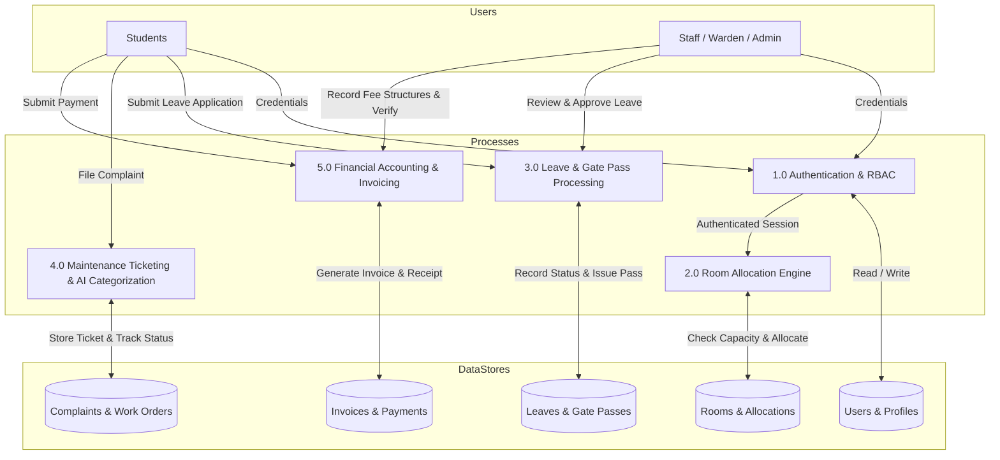

# UML Diagrams & Data Flow Diagrams (DFD)
## HostelOS – System Architecture Diagrams

---

### 1. Use Case Diagram

---

### 2. High-Level Class Diagram

---

### 3. Sequence Diagram: Leave Request & QR Gate Pass

---

### 4. Component Diagram

---

### 5. Level 0 Data Flow Diagram (Context Diagram)

---

### 6. Level 1 Data Flow Diagram

